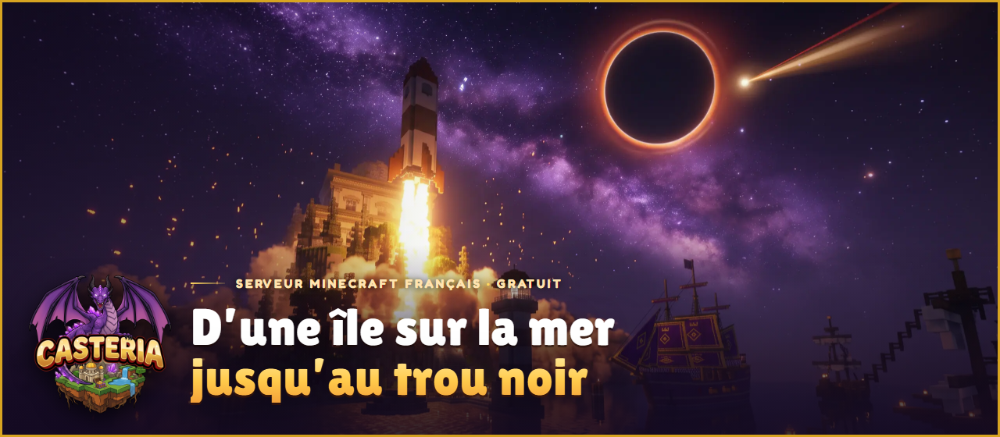
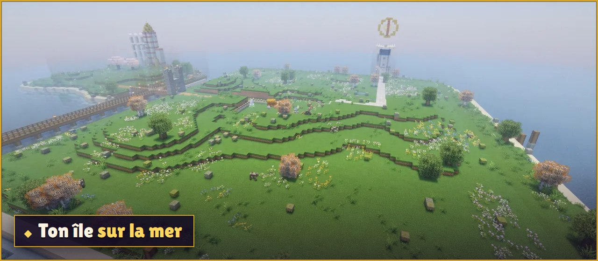
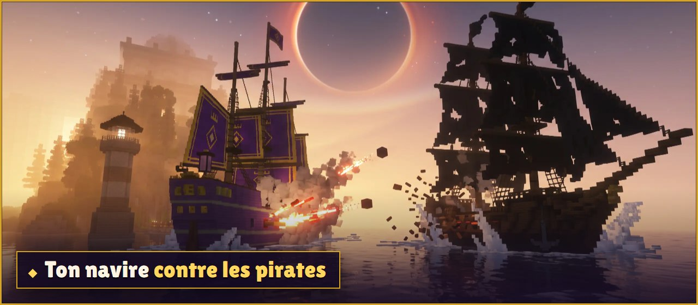
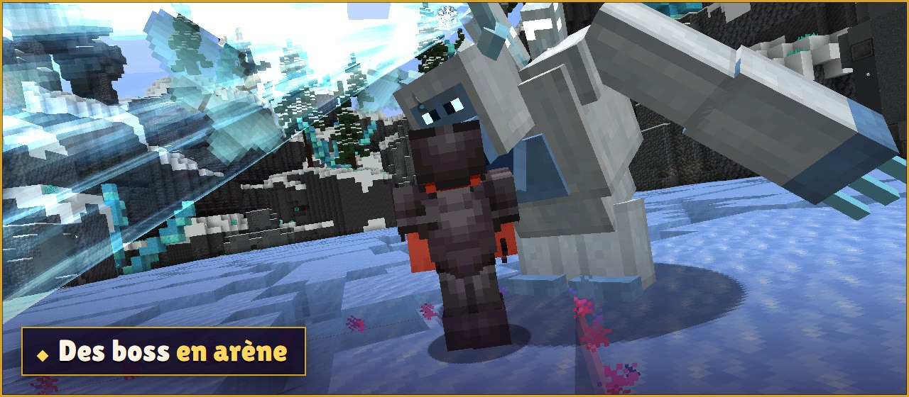
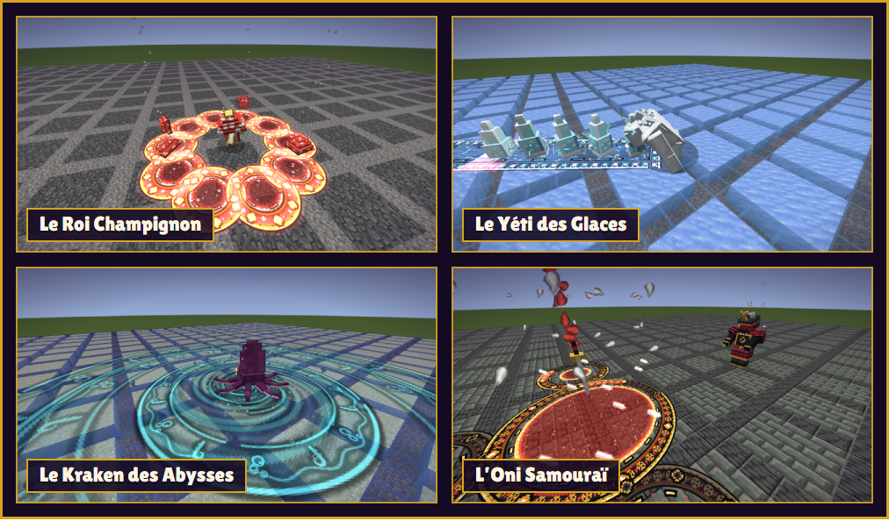
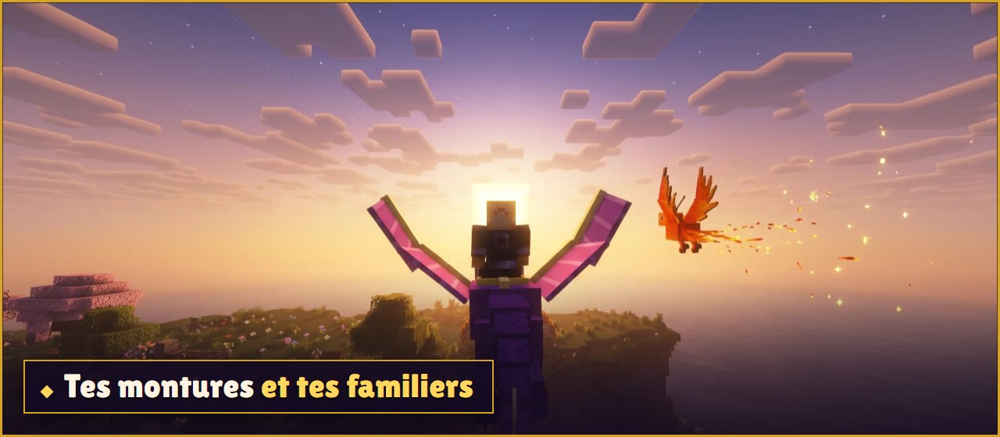
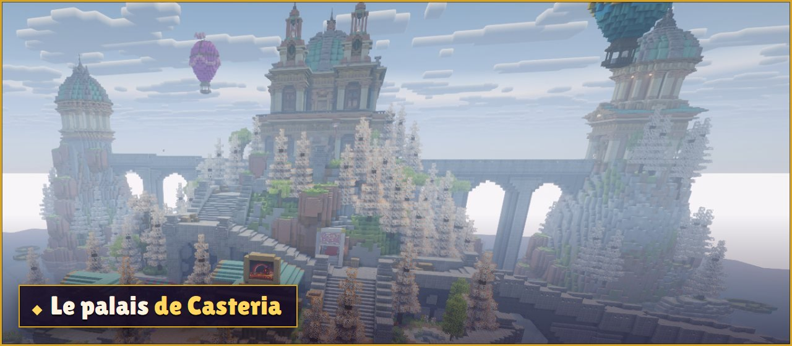
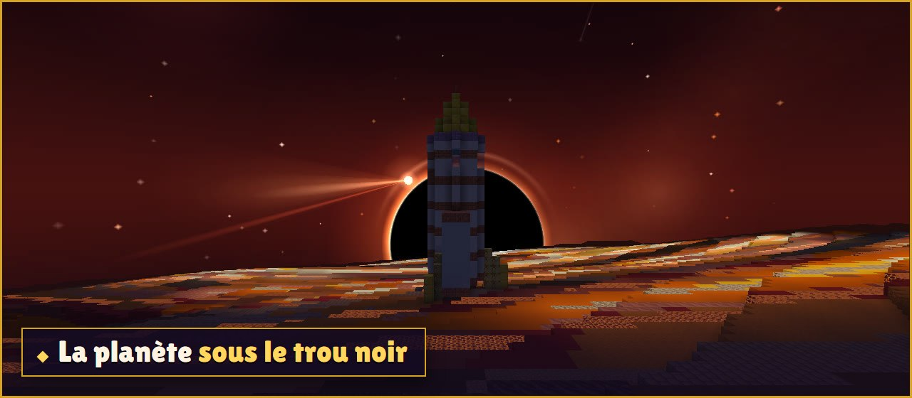
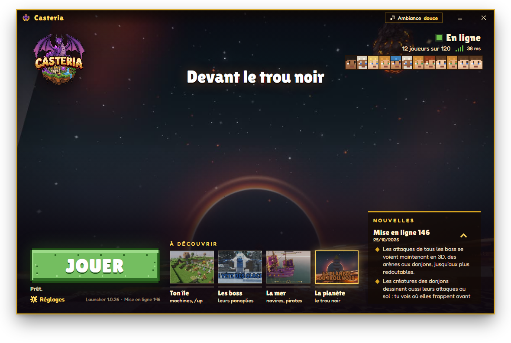

  

  
  
  

  
    Mac : <a href="https://github.com/guerrinflorian/casteria-mc-launcher/releases/download/installateur/Casteria-mac-apple-silicon.zip">puce Apple (M1, M2, M3...)</a>
    ou <a href="https://github.com/guerrinflorian/casteria-mc-launcher/releases/download/installateur/Casteria-mac-intel.zip">processeur Intel</a>
     Linux : <a href="https://github.com/guerrinflorian/casteria-mc-launcher/releases/tag/installateur">choisis ton fichier sur la page d'installation</a>
     <a href="https://github.com/guerrinflorian/casteria-mc-launcher/releases/tag/installateur">L'aide pour installer, système par système</a>
  

<b>Gratuit</b> &nbsp;·&nbsp; Windows, Mac et Linux &nbsp;·&nbsp; le launcher installe tout

**Casteria** est un serveur Minecraft français. Ton île t'attend sur la mer : bâtis-la, fais tourner tes machines et élève tes bêtes, puis prends la barre de ton navire, affronte des boss et décolle vers une planète sous un trou noir. Seul ou avec tes amis.

 

## Jouer en 3 étapes

Casteria se joue seulement avec son launcher : il installe le jeu et les mods du serveur, puis les garde à jour tout seul. Tu n'as rien d'autre à installer.

<table>
  <tr>
    <td width="76" align="center"></td>
    <td><b>Télécharge le launcher</b> Clique sur le bouton de ton ordinateur, juste au-dessus : Windows, Mac ou Linux.</td>
  </tr>
  <tr>
    <td width="76" align="center"></td>
    <td><b>Installe-le</b> Sur Windows, ouvre le fichier : le launcher s'installe tout seul et s'ouvre. Si Windows affiche un écran bleu, clique sur <b>Informations complémentaires</b>, puis <b>Exécuter quand même</b> : c'est normal pour un nouveau programme. Sur Mac et Linux, <a href="https://github.com/guerrinflorian/casteria-mc-launcher/releases/tag/installateur">la page d'installation</a> te montre chaque étape.</td>
  </tr>
  <tr>
    <td width="76" align="center"></td>
    <td><b>Joue</b> Choisis ton pseudo et clique sur <b>JOUER</b>. Le launcher prépare le jeu (quelques minutes la première fois), puis t'emmène directement sur Casteria. En jeu, la première fois, tape <code>/register</code> puis un mot de passe que tu inventes (6 lettres ou chiffres au moins) : tu as une minute pour le faire. Invente-le rien que pour Casteria : jamais celui de ton compte Microsoft ou de ta boîte mail. Ensuite, à chaque connexion, tape <code>/login</code> puis ce mot de passe : tu as 40 secondes. Mot de passe oublié ? Demande à l'équipe sur <a href="https://casteria.fr/discord">le Discord de Casteria</a>.</td>
  </tr>
</table>

 

## Le jeu

  

Gaspard t'accueille au palais, puis ton île t'attend sur la mer. Tes machines produisent toutes seules, tes bêtes ont leurs enclos, et chaque mur repoussé te donne de la place.

 

  

Dès le niveau 15, achète ta Chaloupe à la Borne du port. Coule des pirates, remonte des cargaisons et des trésors, puis prends la barre de navires plus grands, jusqu'au Vaisseau amiral.

 

  

Le Roi Champignon t'attend dès le niveau 3 : tape <code>/boss</code>. Chaque victoire ouvre le boss suivant, et chaque boss a son armure à gagner. Bats un boss une fois : son mode Héroïque s'ouvre, plus dur, avec plus de chances pour chaque pièce de son armure.

  

Leurs attaques se voient en 3D : chaque zone se dessine au sol et se remplit jusqu'au coup. Sors-en avant qu'elle soit pleine !

 

  

Des montures au sol, dans les airs ou dans l'eau, et des familiers qui te suivent partout. Certains ne s'achètent pas : tu les trouves dans ta Mine, en mer, sur la planète ou au fond d'un donjon.

 

  

Au palais, tout le monde se retrouve : Ludovic et ses quêtes, les mini-jeux du soir (tape <code>/participer</code> de partout) et Anselme, qui t'ouvre les donjons, à faire seul ou à trois.

 

  

Au bout de la route, l'Esquif, une fusée en ruine, se rénove sur ton île. Il t'emmène sur une planète sous un trou noir, où l'air se compte et où le sol brûle.

 

**Et aussi :**

- **Des niveaux, de 1 à 70** : chaque grande étape s'ouvre à son niveau, du premier jour jusqu'au bout de la route.
- **Ton île à plusieurs** : avec `/amis`, invite tes amis et choisis leurs droits. Avec le droit Machines, un ami récolte tes machines même sans toi.
- **Des jetons à gagner** : vends tes récoltes au marché (`/sell all`), ou fixe ton prix entre joueurs à l'hôtel des ventes (`/hdv`).
- **Objets et recettes** : `/recettes` ouvre le livre de chaque objet du serveur, sa recette et à quoi il sert.

 

## Le launcher

  

Il garde ton jeu à jour, te montre qui joue en ce moment et ce qui change à chaque mise à jour du serveur, puis t'emmène directement sur Casteria.

- **Il ne touche jamais à ton dossier Minecraft habituel** : tu peux garder ton autre launcher pour tes autres parties.
- **Il ne te demande jamais ton mot de passe** : tu le tapes dans le jeu.
- **Il se met à jour tout seul** : tu n'as rien à retélécharger.
- **Les shaders, en un clic** : dans **Réglages**, allume-les pour une lumière, une eau et un ciel magnifiques, ou coupe-les si le jeu rame.
- **Garde toujours le même pseudo, avec les mêmes majuscules** : ton île et tes jetons sont à ce nom.

 

## Si ça ne marche pas

**Windows bloque le fichier** (écran bleu « Windows a protégé votre ordinateur ») : clique sur **Informations
complémentaires**, puis sur **Exécuter quand même**. C'est normal pour un nouveau programme.

**La première préparation est longue** : la première fois, le launcher télécharge le jeu. Ça peut prendre quelques
minutes, selon ta connexion internet. Ne ferme pas le launcher.

**« Le serveur redémarre ou s'est arrêté. Réessaie dans une minute. »** : attends une minute, puis clique encore sur
**JOUER**.

**« Le serveur est complet pour le moment : réessaie dans quelques minutes. »** : une place va se libérer. Clique
encore sur **JOUER** dans quelques minutes.

**Le jeu rame** : dans **Réglages**, coupe les shaders, ou monte un peu **La mémoire du jeu**.

**Ton île a disparu** : tu as sûrement changé une majuscule de ton pseudo. Remets exactement ton ancien pseudo dans
**Réglages** : ton île revient.

**Mot de passe oublié** : demande à l'équipe sur [le Discord de Casteria](https://casteria.fr/discord).

Un autre souci ? Toutes les solutions, et ce que veut dire chaque message du launcher, sont sur
**[la page d'installation](https://github.com/guerrinflorian/casteria-mc-launcher/releases/tag/installateur)**. Rien n'y
correspond ? Écris à l'équipe sur [le Discord de Casteria](https://casteria.fr/discord) : dis quel ordinateur tu as, et
recopie la phrase que le launcher a écrite.

 

  <a href="https://casteria.fr">Le site de Casteria</a> &nbsp;·&nbsp; <a href="https://casteria.fr/discord">Le Discord</a>

  
    Les autres pages de téléchargement de ce dépôt servent au launcher : il y prend tout seul ce dont il a besoin. Tu n'as
    rien à y télécharger à la main. 
    Casteria n'est pas un produit officiel de Minecraft : il n'est ni approuvé par Mojang ou Microsoft, ni lié à eux.
  

